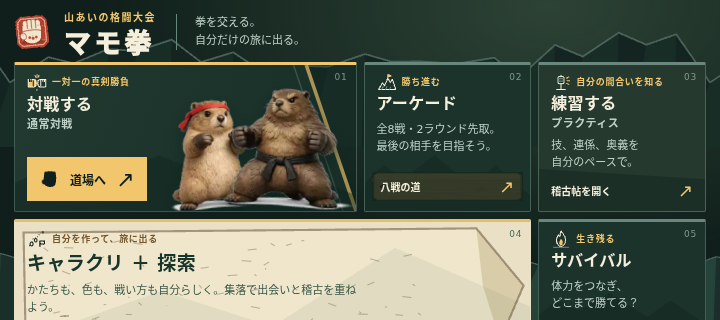
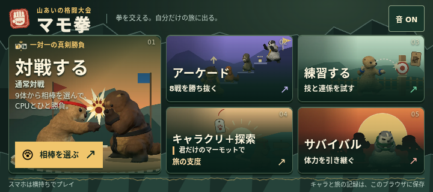
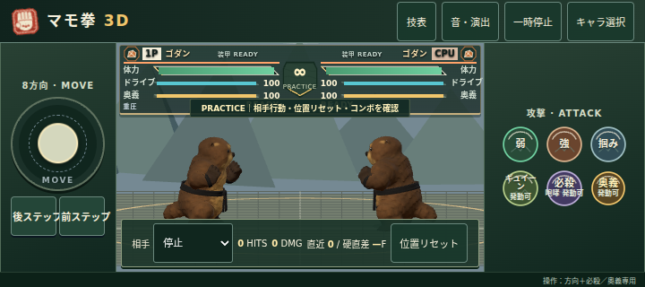
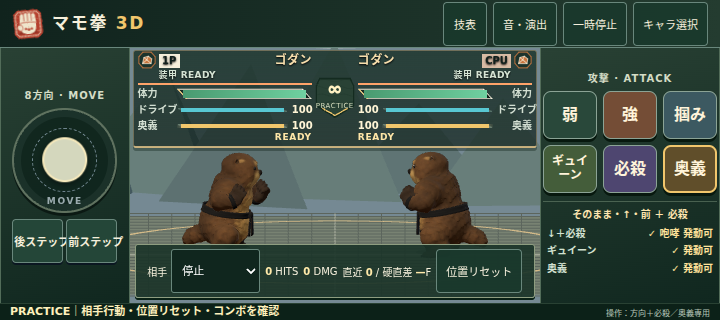
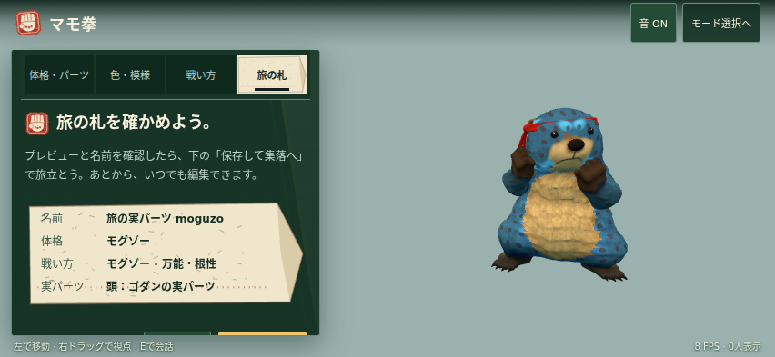
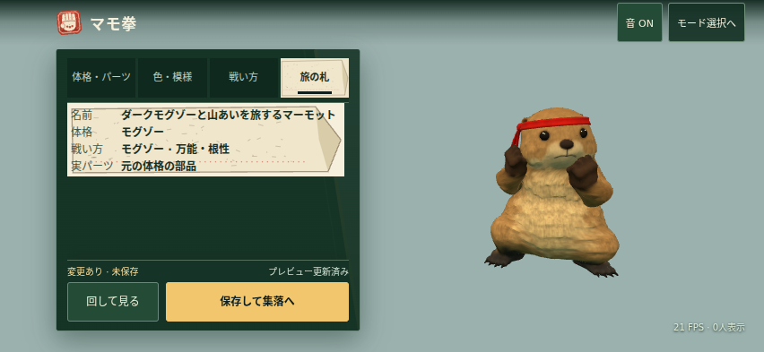

# UI独立評価の原証拠

比較基準は #222 `1391c494`、改善版は #225 `9ee89efa`。UIの実装を固定した後、この記録だけを追加している。

## 実画面の比較

| 画面 | 改善前 | 改善後 |
|---|---|---|
| 入口・720×320 |  |  |
| 練習・720×320 |  |  |
| 保存確認・852×393 |  |  |

保存前後のキャラ／パーツ内容は異なる。画面の情報配置と到達性の比較であり、同じセーブ状態の画素差分試験ではない。

## 動画と生の音声

- [全体の操作動画・MP4互換版（無音）](after-9ee89efa/ui/p4-interactions.mp4)：入口→相棒→対戦／練習／連戦→編集／保存の状態遷移。
- [実音声付き確認動画・MP4互換版](after-9ee89efa/audio/ui-with-audio.mp4)。[元の音声付きWebM](after-9ee89efa/audio/ui-with-audio.webm)は元byteを保存。
- [UI Contextの生録音](after-9ee89efa/audio/audio-context-1.webm)／[戦闘Contextの生録音](after-9ee89efa/audio/audio-context-2.webm)。
- [音声計測JSON・gzip](after-9ee89efa/audio/report.json.gz)／[近似同期の記録](after-9ee89efa/audio/mux-receipt.json)。

音付き動画はページ生成と録音開始の時刻による**近似同期**。正確な遅延やフレーム単位の同期、人間の聴感品質を認証しない。MP4はH.264への互換変換で、元動画のhashと変換内容をmanifestへ記載。動画の符号化FPSをゲームの実機FPSとは扱わない。今回の音声記録は保存音のStory実経路を含まない。

## 状態列と未解決の見た目

[VS](after-9ee89efa/core/a1-vs-portrait-locked.png) → [1P顔寄り](after-9ee89efa/core/a2-face-1p.png) → [CPU顔寄り](after-9ee89efa/core/a3-face-cpu.png) → [FIGHT](after-9ee89efa/core/a4-fight-call.png) → [KO](after-9ee89efa/core/a5-ko-slow.png) → [勝利](after-9ee89efa/core/a6-victory.png) → [結果](after-9ee89efa/core/a7-result.png)。[低刺激設定のKO](after-9ee89efa/core/e1-ko-reduced-motion.png)は状態画像で、軽減動作の体感評価は別。

[安全領域付き短画面の確認札](after-9ee89efa/polish/editor-safe-720x320-tab3.png)は全4行と保存操作を保持。[Storyの操作／不足状態](after-9ee89efa/polish/story-controls-safe-720x320-unavailable.png)には、小さい補助ラベル・改行の残課題も記録している。

## 照合と範囲

[manifest.json](manifest.json)に全保存物のSHA256・サイズ・元SHA/run/artifactを記録。原PNGと生音声は元byteを保持し、JSONは可逆gzip圧縮（展開後hashも記載）。元の完全なCIアーカイブへのリンクもmanifest内に保持している。このフォルダは独立UI審査用の選択証拠で、すべての回帰出力を複製したものではない。

Chromium／SwiftShader・タッチ模擬・720×320／852×393／縦持ち回転・CDP安全領域での記録。人間試遊0名、物理iPhone未試験。採否は[独立評価](../../reviews/P4_POLISH_FINAL_9EE89EFA.md)と[機能受領書](../../reviews/P4_POLISH_REGRESSION_9EE89EFA.md)を分けて読む。
