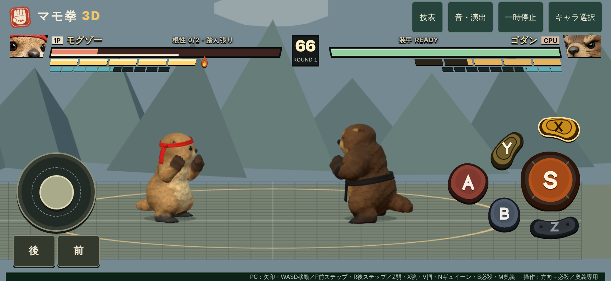
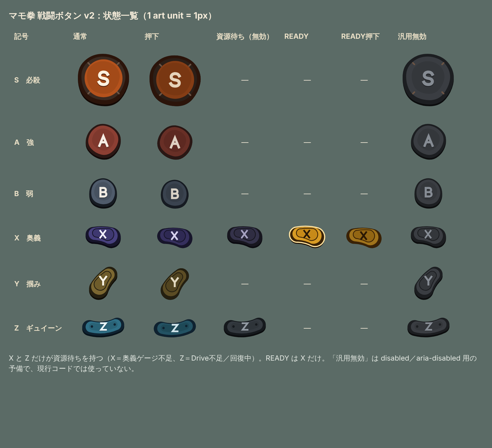
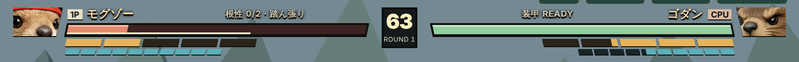

# 20｜戦闘ボタン・上部HUD ビジュアル v2（実装前提のデザイン仕様）

- 実装ベース：[Draft PR #230](https://github.com/nagi300222/mamo-ken/pull/230) HEAD `3019f142`（`feat/mamoken-matte-battle-ui`）。main未マージ。
- 役割：アートディレクション＝Claude、実装＝Codex。この文書がCodexへの正本。
- 制作物（このPRで追加。どれもゲームにはまだ接続していない）
  - `exp/fable-3d/shared-ui/battle-control-art-v2.js`：ボタン6個のSVGレイヤー・記号・色・状態の**実行時データ**（唯一の正本）
  - `exp/fable-3d/shared-ui/matte-battle-v2.css`：ボタン状態とHUDの**参照CSS**（そのまま採用できる完成形）
  - `design/battle-ui-v2/preview.html`：全ボタン×全状態のデザインボード
  - `design/battle-ui-v2/verify-overlay.cjs`：上の2ファイルを実ゲームに重ねて、当たり判定の不変とHUD・ボタンの重なりを測る検証スクリプト
  - `design/battle-ui-v2/evidence/`：PR #230と v2 の比較画像、当たり判定の実測JSON

---

## 1. デザイン方針

**狙い**：「押せる部品」と「読むゲージ」を分ける。ボタンは厚みのある不透明な物体として描き、HUDは枠や表を描かずにゲージそのものを見せる。

**この方向にした理由**
- スマホ格闘ゲームでは、指でボタンが隠れる。色と形と厚みで、押したことが指の外からも分かる必要がある。透明なボタンは3Dステージの色に負けるので、不透明・マットにする。
- ボタンは記号だけにする。意味は技表やチュートリアルで覚えてもらう。代わりに、役割ごとに形と装飾の「家族」を分けて、記号を読まなくても役割の重さが分かるようにする。
- HUDは毎フレーム目に入る。ラベル・数値・枠を減らすほど、戦闘画面に馴染む。

**PR #230 から何を変えるか**

| 対象 | PR #230（現状） | v2 |
|---|---|---|
| ボタン記号 | HTMLの文字（フォント依存、端末で太さが変わる） | SVGの記号（6文字すべて専用の線画、端末差なし）＋1単位下の濃色の影で刻印風 |
| ボタンの厚み | 外周・面・内面の3層、影なし | 3.2単位下にずらした**台座**を追加。押すと本体が3単位沈み、台座が隠れる |
| 役割の差 | 色と外形のみ | S＝鉄の襟＋芯＋鋲4つ ／ A・B＝無地の皿 ／ X・Y＝外形に沿う彫り溝 ／ Z＝両端の止め |
| 押下 | 色が少し暗くなり、内面と文字が2px下がる | 面・皿を約26%暗く、本体を3単位沈め、記号の影を消す（指の脇から見ても分かる） |
| 資源待ちのX | ほぼ灰色（Xの色が試合中ほとんど見えない） | **暗い藍**。Xの色を保ったまま「まだ押せない」を示す |
| READYのX | 金色＋細い縁 | 金色＋淡金のリング（READYになった瞬間に1回だけ縮んで定着、ループしない） |
| 見た目の大きさ | 当たり判定と同寸 | 見た目だけ S 95%／A・B・Z 92%／X・Y 90%。**当たり判定は1pxも変えない** |
| HUDの構成 | 名前帯・ラベル列（体力/奥義/Drive）・数値列・ガード行の「表」 | 目のプレートからHPバーが伸びる一体形。ラベル・数値・ガード行は画面から外し、読み上げ用に残す |
| HUDの枠 | ラスター画像の枠（`--p4-art-hud-*-frame`） | 枠画像なし。HPだけ2pxの濃色輪郭、奥義とDriveは「区切られた色の塊」だけ |
| HUDの高さ | 約73px（720×320でXボタンの当たり判定と17px重なる） | 51px（高さ340px以下の画面は43px）。720×320でもXの当たり判定の上端より13px上で終わる |



---

## 2. 固定条件一覧

### 絶対に変えないもの
1. **当たり判定**：`button[data-control]` の位置・幅・高さ・`clip-path`。計算式は PR #230 の `matte-battle.css` のまま（`--art-unit`、`--cx`/`--cy`、`max(44px, art × unit)`）。v2 の CSS はこれらのプロパティを一切書かない。
2. **配置**：右寄せ。S中心、左上A・左下B、上にY（左）とX（右）、Sの下にZ。`bounds`（外接矩形）と `ART_REFERENCE {left:574, top:140}` は PR #230 と同値。
3. **外形**：6個の `rim`／`face`／`edge(dish)` パス。Y・Xは同系の湾曲豆形、Zは丸端の弧。
4. **役割と記号**：A＝強、B＝弱、X＝奥義、Y＝掴み、Z＝ギュイーン、S＝必殺。
5. **入力**：`data-control` の値、`BATTLE_INPUT_PROFILE`（物理キー `KeyZ`=弱、`KeyX`=強、`KeyV`=掴み、`KeyN`=ギュイーン、`KeyB`=必殺、`KeyM`=奥義）、`.held` の付け外し（`dojo/main.js`・`story/main.js`）、ポインター捕捉、技表を開いたときの入力解除。
6. **押せる条件**：戦闘ルールが決める。`data-wait`／`data-ready` は `updateBattleHUD()` が今と同じ条件で付ける（X＝`super>=100`、Z＝`driveStatus('gyuiin')==='発動可'`）。
7. **HUDのDOM id**：`hp-*`、`meter-*`、`drive-*`、`super-value-*`、`drive-value-*`、`ultimate-ready-*`、`guard-value-*`、`name-*`、`ability-*`、`trait-*`、`charge-pips-*`、`hud-eye-*`、`hud-side-*`、`timer`、`round-message`。テストと Story が参照している。
8. **ゲージの向き**：1Pは画面左端（目の側）から、CPUは画面右端から伸びる。READYの炎は奥義ゲージの内側端（中央寄り）。
9. **目画像**：HUDの左右外端。既存の `facesq_*.png` と `eyeCrop` の焦点座標を使う。
10. 全画面3Dステージ（ボタンの下までステージが続く）、カメラのフレーミング、KO・奥義の専用カメラ。

### 変えてよいもの
- ボタンの見た目（色・層・記号・影・押下表現・見た目の縮小率）
- HUDの見た目（行の高さ、ラベルと数値の表示有無、枠、色、目プレートの形、タイマーの見た目）
- 技表の表記（`battleButtonGuide`）は今のままでよい。変える場合も物理キー表記と混ぜない

### 注意点
- **画面の記号と物理キーは別物**。画面の「X」は奥義だが、物理キーの `X` は強攻撃。v2 は画面表記だけを扱う。`keyMap` を読み替えたり、記号から物理キーを推測するコードを書かない。
- 見た目を縮めても、当たり判定は縮めない（`--art-scale` は `.attack-art` だけに掛かる）。
- 「透明感は不要」：ボタンの全レイヤーは不透明色。`opacity` を使うのはREADYリングと記号の影の表示切替だけ。
- 上部の常時メニュー（技表・音・演出・一時停止・キャラ選択）と下部の操作説明文はこの仕様の対象外。別タスクで扱う。

---

## 3. 戦闘ボタン仕様

### 共通
- **単位**：SVGの1単位＝`--art-unit`（`clamp(.77px, .225cqh, 1px)`）。852×393で0.884px、720×320で0.77px。
- **当たり判定（実測、PR #230と同値）**

| 記号 | 852×393 | 720×320 |
|---|---|---|
| S | 91.1×90.2 | 79.3×78.5 |
| A | 65.4×64.6 | 57.0×56.2 |
| B | 53.1×54.8 | 46.2×47.7 |
| Y | 54.8×61.0 | 47.7×53.1 |
| X | 67.2×44（下限） | 58.5×44（下限） |
| Z | 77.8×44（下限） | 67.8×44（下限） |

- **レイヤー（下から）**：`bt-base`（台座）→ `bt-body` グループ［`bt-rim` 外周 → `bt-face` 面 →（Sのみ `bt-core`＋`bt-ticks`）→ `bt-dish` 皿 →（X/Y `bt-groove`、Z `bt-pip`）→ `bt-glyph`（`bt-glyph-shade`→`bt-glyph-ink`）］→（Xのみ `bt-ring`）
- **台座**：外周と同じパスを下へ3.2単位ずらし、`base` 色で塗る。ぼかしなしの物理的な厚み。
- **記号**：24×24グリッド、字高18単位の線画。線幅4.4、`stroke-linecap:square`、`stroke-linejoin:miter`、`miterlimit:3`。`translate(0 1.1)` 下に `shade` 色の同形を敷いて刻印に見せる。記号の大きさ（字高）は下表の「記号」列。
- **色**は6色の組（`base`／`rim`／`face`／`dish`／`glyph`／`shade`）で状態ごとに持つ。正確なHEXは `battle-control-art-v2.js` の `SPEC` が正本。

### S ＝ 必殺（核）
- 見た目：一番大きい。濃い鉄色の**襟**（face層を `#3A2A21` で塗る）の内側に、焦がし橙の**芯**（円 r36.5）、その中に一段暗い皿。襟の斜め4か所に鋲（`#6B5444`、線幅3、丸端）。
- 記号：S、字高24、中心 (51.4, 49.2)。
- 見た目の縮小率：0.95
- 状態：通常／押下。資源待ち・READYはない（咆哮の可否は `aria-label` だけ）。
- 補足：6個の中で唯一「二重の円」。画面の視線の中心になる。

### A ＝ 強（通常技）
- 見た目：煉瓦色の丸い皿。装飾なし。
- 記号：A、字高19、中心 (37, 36)。縮小率 0.92。状態：通常／押下。

### B ＝ 弱（通常技）
- 見た目：スレート色の小さい丸い皿。Aと同じ家族で、寒色・小型。
- 記号：B、字高17、中心 (29.4, 29.8)。縮小率 0.92。状態：通常／押下。

### Y ＝ 掴み（特殊）
- 見た目：オリーブ黄土の湾曲豆形。皿の外周に沿って外周色の彫り溝（線幅1.6）。
- 記号：Y、字高16、中心 (30.6, 30.4)。縮小率 0.90。状態：通常／押下。

### X ＝ 奥義（特殊）
- 見た目：藍の湾曲豆形＋彫り溝（Yと同じ家族）。
- 記号：X、字高14、中心 (37, 18.2)。縮小率 0.90。
- 状態：資源待ち（暗い藍、記号 `#A6A2C2`）／READY（金 `#D89B24`、記号は濃茶 `#2A1804`、影は淡金で浮き彫り、外周に淡金のリング `#FFE3A0` 線幅2.4）／READY押下（暗い金、リングを消す）。通常（明るい藍）は `data-wait` も `data-ready` も付かない時の色で、現行ロジックでは対戦外の表示用。
- 補足：READYの金は奥義ゲージの金と同じ系統。「ゲージがXに流れ込んだ」と読める。

### Z ＝ ギュイーン（補助）
- 見た目：深い青緑の丸端の弧。両端に外周色の止め（r2.4）を打つ。皿・溝はなし（Sの芯、A/Bの皿、X/Yの溝のどれとも違う）。
- 記号：Z、字高14、中心 (44.3, 19.6)。縮小率 0.92。
- 状態：通常／押下／資源待ち（灰、記号 `#929AA2`）。
- 補足：青緑はDriveゲージと同じ系統。Driveが足りないとZが灰になる関係を色で結ぶ。



---

## 4. HUD仕様

構成（1Pの場合。CPUは左右反転）：

```
[目プレート]┃1P モグゾー           根性 0/2      ← 名前行 14px（背景なし）
[  52×31   ]┃▰▰▰▰▰▰▰▰▰▰▰▰▰▰▰▰▰▰▰▰▰▰▱▱▱▱▱▱      ← HP 14px（全幅・2px輪郭）
             ▰▰▰▰ ▰▰▰▰ ▰▰▰▰ ▱▱▱▱ ▱▱▱▱ 🔥       ← 奥義 8px（幅64%・5ブロック）
             ▰▰ ▰▰ ▰▰ ▰▰ ▰▰ ▱▱ ▱▱ ▱▱ ▱▱ ▱▱  ●●●  ← Drive 6px（幅52%・10セル）＋固有のピップ
```

- **全体**：開始位置は今と同じ（`top: safe-top + 49px`、左右は safe area＋6px以上）。行は 14／14／8／6px、行間3px＝合計51px。コンテナの高さが340px以下なら 13／12／7／5px、行間2px＝43px。左右の間は48pxのタイマー列と10pxの隙間。
- **傾き**：HP・奥義・Driveのトラックは `skewX(-12deg)`（CPU側は `+12deg`）。目プレートの内側の辺も同じ角度で斜めに切る（下辺を7px短く）。HPの外側の端が目プレートの斜辺と噛み合い、HUDが一つの部品に見える。
- **影**：`.hud-side` に `drop-shadow(0 1px 0 #0B0D0B)` を1つ。ぼかしはなし。

### HP（長い競技バー）
- 幅100%（目プレートの隣からタイマー列まで）、高さ14px、輪郭2px `#0E100E`、空き `#3B2420`。
- 残量 `#93CDA0`＋上端2px `#C6E8CC`。25%未満（`.low`）は `#E4876D`＋上端 `#F4B7A3`。
- **ガード線（新規）**：HPトラックの下端に高さ2px `#EDE3CA` の線。幅＝`guard / guardMax`。満タンのときは非表示（`data-full`）。ガードの数値行の代わり。

### 奥義（分割ゲージ・5ブロック）
- 幅64%、高さ8px、5ブロック（ブロック間3px）、空き `#2A2317`、充填 `#E4B35C`。端数は途中まで描く（今と同じ連続幅）。
- READY（`i.ready`）：`#FFD66E`＋上端2px `#FFF1C4`。

### Drive（分割ゲージ・10セル）
- 幅52%、高さ6px、10セル（セル間2px）、空き `#182526`、充填 `#5DAFB8`。
- 奥義（太い5ブロック・金）とDrive（細い10セル・青緑・短い）は、本数・太さ・長さ・色の4点で区別する。
- バレットのチャージピップ（`charge-pips-*`）はDrive行の内側（中央寄り）の空きに置く。

### READY演出（奥義100）
同時に3つ起きる。どれもループしない（炎の揺れだけ既存のまま）。
1. 奥義の5ブロックが `#FFD66E` に明るくなる。
2. 奥義ゲージの内側端の3px外に炎（既存 `readyFlame`、12×16px）。揺れは既存の `mamoken-ready` 1秒交互。モーション軽減時・演出オフ時は静止。
3. Xボタンが金に変わり、淡金のリングが1回だけ（420ms）締まって定着する。
- 「READY」の文字は画面に出さない（`.ultimate-ready>span` は読み上げ用に残す）。
- 派手さの上限：発光・ぼかし・画面全体のフラッシュ・繰り返しの点滅は使わない。

### 目画像との関係
- 目プレート：幅 `clamp(44px, 6.2cqw, 56px)`、高さは名前行＋HP行（31px）、背景 `#0E100E`、枠線なし。画像は幅205%で既存の `--eye-x`/`--eye-y` を中心に切り抜く（目の帯だけが見える）。CPU側は既存どおり左右反転。
- 目プレートが「持ち手」、HPバーがそこから伸びる「刃」。外側から内側へ、目→HP→奥義→Driveの順に短くなる。

### 枠やラベルの扱い
- 画面から外す（DOMには残し、視覚的に隠す）：「体力」「奥義」「Drive」の文字、奥義とDriveの数値、`READY` の文字、`trait-word`、「ガード 100」。
- 残す：1P/CPUの札（9px）、キャラ名（11px）、固有能力の状態（9px、例「根性 0/2」）。
- 枠：ラスター枠画像（`p4-art.css` の `--p4-art-hud-hp-frame`／`--p4-art-hud-sub-frame`／`--p4-art-hud-timer-dark`）を戦闘HUDでは使わない。名前帯の背景もなし。
- タイマー：48px幅の濃色板（`#15191A`、輪郭2px `#0B0D0C`、角丸なし）、数字22px、ラウンド表記7px。
- 意味の説明は技表に載せる（下記 §6 の `#commands-help` への追記）。



---

## 5. 状態設計

| 状態 | 誰が付けるか（DOM） | 対象 | 見た目 |
|---|---|---|---|
| 通常 | なし | 全ボタン | `SPEC[記号].normal` の6色。台座が3.2単位見える |
| 押下 | `.held`（既存の pointerdown／up） | 全ボタン | `pressed` の6色（面・皿を約26%暗く）。`bt-body` を3単位下げ、記号の影を消す。台座はほぼ隠れる。40msの線形移動。モーション軽減時は移動なし、色だけ |
| 資源待ち（＝この画面での「無効」） | `[data-wait]`（`updateBattleHUD`） | X（奥義<100）、Z（ギュイーン不可） | X＝暗い藍、Z＝灰（`wait` の6色）。押すことはできる（入力は戦闘ルールが判定）。押下時は押下色が優先 |
| READY | `[data-ready]`（`updateBattleHUD`） | Xのみ | 金の6色＋リング。付いた瞬間にリングが420msで1回締まる |
| READY押下 | `[data-ready].held` | Xのみ | 暗い金（`readyPressed`）、リングを消す |
| 汎用無効（予備） | `:disabled` または `[aria-disabled=true]` | 全ボタン | 共通の灰（`DISABLED`）。現行コードでは使っていない。将来の操作ロック用 |
| フォーカス | `:focus-visible` | 全ボタン | 外周に2px `#FFF0B5` の線（既存と同等） |

- **優先順位**（後ろほど強い）：通常 → 資源待ち → READY → 押下 → READY押下 → 汎用無効。CSSの記述順で実現している（`matte-battle-v2.css` §1）。
- HUDの状態：HP `.low`（25%未満）、奥義 `i.ready`、READYの炎 `[hidden]`、ガード線 `[data-full]`。どれも既存か `updateBattleHUD` が付ける。

---

## 6. Codex向け実装仕様

### 分担
| 層 | 担当すること | ファイル |
|---|---|---|
| データ（JS） | パス・記号・色・縮小率・状態色。**唯一の正本** | `shared-ui/battle-control-art-v2.js`（このPRで追加済み。中身は変更しない） |
| DOM生成（JS） | ボタンのSVG挿入、HUDのガード線要素の追加 | `shared-ui/battle-ui.js` |
| 状態切替（JS） | 既存の `.held`／`data-wait`／`data-ready` をそのまま使う。追加はガード線の幅と `data-full` だけ | `shared-ui/battle-ui.js` の `updateBattleHUD()` |
| 見た目（CSS） | 状態ごとの色の選択、押下の移動、READYリング、HUDの全レイアウト | `shared-ui/matte-battle-v2.css`（このPRで追加済み） |
| 当たり判定（CSS） | **変更しない** | `shared-ui/matte-battle.css` |

### 手順（この順で行う）
1. `exp/fable-3d/dojo/index.html` と `exp/fable-3d/story/index.html` の `matte-battle.css` の直後に `<link rel="stylesheet" href="../shared-ui/matte-battle-v2.css">` を追加する。
2. `shared-ui/battle-ui.js`
   - `import {battleControlArt, readyFlame} from './battle-control-art.js'` を `import {battleControlArtV2 as battleControlArt, readyFlame} from './battle-control-art-v2.js'` に置き換える。
   - `battleControlsMarkup()` の `<span class="attack-art">` の中身を次にする：`${art.svg}<span class="attack-label">${b.label}</span>`。`button` の `style="${art.style}"`、`data-control`、`class`、`aria-label`、`<small id=status>` は今のまま。
   - `battleHUDMarkup()` の HP の `.track` の中、`<i id="hp-${i}"></i>` の直後に `<b class="guard-line" id="guard-line-${i}" data-full aria-hidden="true"></b>` を追加する。
   - `updateBattleHUD()` のループ内に追加：`const g=find('guard-line-'+i); if(g){const v=clamp(p.guard/r.guardMax*100,0,100); g.style.width=v+'%'; g.toggleAttribute('data-full',v>=100);}`
3. 旧ファイル `shared-ui/battle-control-art.js` を削除する。他に import している箇所がないことを `grep -rn "battle-control-art'" exp/fable-3d` で確認する。
4. `shared-ui/matte-battle.css` から、v2 と重複して効かなくなった次の規則を削除する（当たり判定の規則は残す）：`.attack-rim`／`.attack-face`／`.attack-edge` の `fill`、`.attack{--art-rim…}`、`.attack[data-wait]`、`.attack[data-ready]`、`.attack.held` の色変数、`.attack.held :is(.attack-edge,.attack-label)`、`.attack[data-ready] .attack-edge`、`.attack:focus-visible .attack-rim`。**残すもの**：`button.attack[data-control]` の位置・寸法・`clip-path`（`.attack.heavy`／`.attack.special`）、`.gyuiin` の `--hit-offset`、`.attack-art` の寸法と位置、`.attack-art svg`。
5. 技表（`dojo/index.html` と `story/index.html` の `#commands-help`）に1行追加：`ゲージ：長い緑＝体力／金の5ブロック＝奥義（満タンでXが金色）／青緑の10セル＝Drive（Zと咆哮で消費）／体力の下の白線＝ガード`。
6. テストを更新する（§7の自動テスト項目）。

### コンポーネント構造（ボタン1個）
```html
<button type="button" data-control="ultimateButton" class="attack ultimateButton" aria-label="奥義" style="--cx:…;--cy:…;--art-w:76;--art-h:46;--art-scale:.9;--n-*:…;--p-*:…;--w-*:…;--r-*:…;--rp-*:…">
  <span class="attack-art" aria-hidden="true">
    <svg class="bt" data-symbol="X" viewBox="0 0 76 46">
      <path class="bt-base"/>                 <!-- 台座：押下で動かない -->
      <g class="bt-body">                     <!-- 押下で3単位沈む -->
        <path class="bt-rim"/><path class="bt-face"/><path class="bt-dish"/><path class="bt-groove"/>
        <g class="bt-glyph"><path class="bt-glyph-shade"/><path class="bt-glyph-ink"/></g>
      </g>
      <path class="bt-ring"/>                 <!-- Xのみ。READYで表示 -->
    </svg>
    <span class="attack-label">X</span>       <!-- 視覚的に隠す。テストと代替用 -->
  </span>
  <small id="ultimate-status" hidden></small>
</button>
```
- SVGに持たせるもの：形（パス）、記号の線、層の順番。色は持たせない（`fill`/`stroke` はすべてCSS変数）。
- CSSに持たせるもの：状態に応じた色変数の切替（`--a-*`）、押下の `translate`、READYリングの表示とアニメーション、見た目の縮小（`scale:var(--art-scale)`）。
- JSに持たせるもの：SVG文字列の挿入（初回だけ）、既存の状態属性の付け外し。毎フレームSVGを作り直さない。

### レスポンシブ・safe area
- ボタン群の位置・単位は `matte-battle.css` の既存式のまま。v2 は触らない。
- HUDの開始位置・左右の余白は既存の `--ui-safe-*`／`--battle-safe-*` の式のまま。v2 が変えるのは行の高さ・列・見た目だけ。
- 高さ340px以下は `@container (max-height:340px)` で HUDを43pxに詰める（`#app`／`#story-app` は既に `container-type:size`）。
- 縦持ち→横表示（`html.landscape-locked`）、左右ノッチ、ネイティブ（`html.native-runtime`）はPR #230の既存経路のまま。
- iOS Safari向けに `mask-image` と `-webkit-mask-image` を両方書く（参照CSS済み）。`scale`／`translate` プロパティは iOS 14.5以降で動く。

### 既存ロジックと切り離してはいけない点
- `.held` の付け外しは `main.js` の pointer 処理が行う。v2のために別の押下クラスや別のイベントを作らない。
- `data-wait`／`data-ready` の判定式を見た目側で再計算しない。`updateBattleHUD()` の既存式だけを使う。
- 技表・音・演出設定を開いたときの入力解除とポインター解放は既存のまま。
- `aria-label` の更新（ギュイーン・必殺・奥義の状態読み上げ）は消さない。
- Story（`#story-app[data-mode=battle] #battle-buttons`）にも同じマークアップが入る。Dojoだけ直してStoryを忘れない。
- `exp/fable-3d/cinematic/v14/*_animations.glb` は生成物（`node exp/fable-3d/dojo/pack-showtime.mjs`）。ローカル検証で起動しないときはこれを先に実行する。

### 変更禁止事項（まとめ）
- `button[data-control]` の `left`／`top`／`width`／`height`／`min-*`／`margin`／`clip-path`／`transform` を変えない。
- `battle-control-art-v2.js` の `bounds`、`ART_REFERENCE`、`RIM`／`FACE`／`DISH` を変えない。
- `BATTLE_INPUT_PROFILE`、`keyMap`、戦闘ルール、保存スキーマ、カメラを変えない。
- ボタンに透明・半透明の塗り、ぼかし、グラデーションの光沢を入れない。
- READY演出をループさせない（炎の揺れを除く）。画面全体のフラッシュを足さない。

---

## 7. 受け入れ条件

### 当たり判定・操作（自動）
- [ ] 852×393、720×320、左ノッチ720（58/20/21）、右ノッチ720（20/58/21）、縦393×852（横表示）の5条件で、全 `[data-control]` の `getBoundingClientRect()` が PR #230 と ±0.01px 以内で一致する（基準値は `design/battle-ui-v2/evidence/hit-area-report.json` の `before`）。
- [ ] 同5条件で、各ボタンの中心の `elementFromPoint` がそのボタン自身を返す（既存 `matte-battle-browser.mjs` の検査が通る）。
- [ ] 6操作が実戦で各1回発動する（既存テスト）。
- [ ] 押下中のボタンに `.held` があり、`.bt-body` の計算後 `translate` が `0px 3px`（モーション軽減時は `none`）。

### 見た目（自動）
- [ ] 各ボタンに `svg.bt` が1つ、`.bt-base`・`.bt-rim`・`.bt-face`・`.bt-dish`・`.bt-glyph-ink` が各1つある。Sに `.bt-core` と `.bt-ticks`、X/Yに `.bt-groove`、Zに `.bt-pip` 2つ、Xに `.bt-ring` がある。
- [ ] `.attack-label` の文字が B/A/Y/Z/S/X のまま（既存テスト）で、画面上は見えない（幅1px）。
- [ ] 奥義100で Xに `data-ready`、`.bt-face` の計算後 `fill` が `rgb(216, 155, 36)`、`.bt-ring` の `opacity` が `1`。奥義<100で `data-wait`、`fill` が `rgb(52, 50, 74)`。
- [ ] Drive不足で Zの `.bt-face` が `rgb(51, 57, 63)`。
- [ ] 全HUDの `.hud-side` の下端が、Xボタン（当たり判定）の上端より上にある（5条件すべて）。
- [ ] HUD内に「体力」「奥義」「Drive」の文字と数値が見えない（`clip-path:inset(50%)`）。DOMには残っている。
- [ ] `.track` の `background-image` が `none`（ラスター枠を使っていない）。
- [ ] ガード線：ガード満タンで非表示、減ると幅が `guard/guardMax` に一致する。
- [ ] モーション軽減時と演出オフ時、READYの炎とリングの `animationName` が `none`。
- [ ] ページエラー・HTTP 4xx がない。

### 目視（人間）
- [ ] 押したボタンが指の脇から分かる（ナギの物理iPhoneでの試遊）。
- [ ] Sが中心に見え、A/B・X/Y・Zが別の役割に見える。
- [ ] HUDが「表」ではなく、目からゲージが伸びる一つの部品に見える。
- [ ] 奥義READYに気づけるが、戦闘の邪魔にならない。

### 回帰
- [ ] Dojo・共通UI・Story・native のNodeテスト、GitHub ActionsのWebGL・P4回帰が成功する。
- [ ] Storyの戦闘画面で同じボタンとHUDが出る。

---

## 検証の記録（このPR）

- 参照CSSとデータを、PR #230 の実ゲーム（Chromium、WebGL）に `verify-overlay.cjs` で重ねて測定した。ゲームのコードは変更していない。
- 当たり判定：852×393・720×320・左右ノッチ・縦393×852（横表示）の5条件で、8要素（6ボタン＋前後ステップ）すべてが PR #230 と一致（差0）。
- HUDの下端：PR #230 は122px（720×320でXの当たり判定の上端105pxと17px重なる）、v2 は 852×393で100px、720×320で92px。
- 縦393×852（横表示）は画面を目視で確認し、HUDとボタンの重なりはなかった（回転中は矩形の比較が使えないため、HUD下端の数値比較は横長4条件のみ）。
- 未実施：物理iPhone、本人の目視判定、ゲームへの組み込み後のテスト一式（Codexの実装後に行う）。
