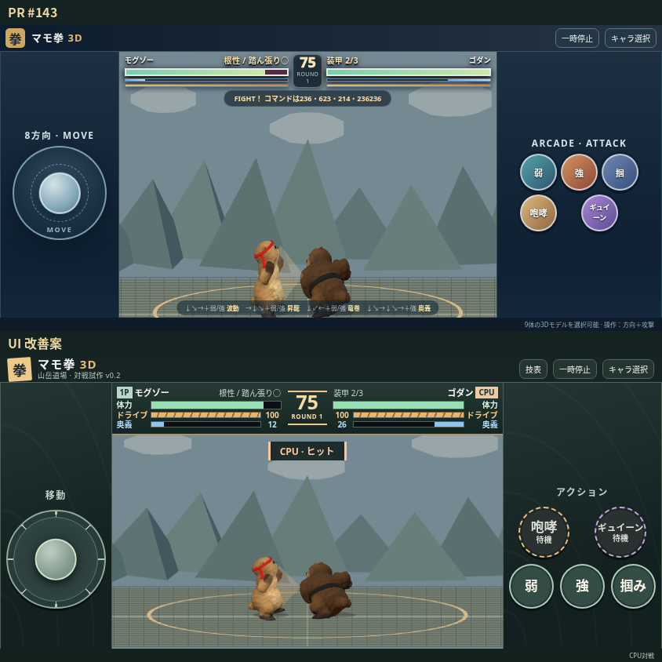
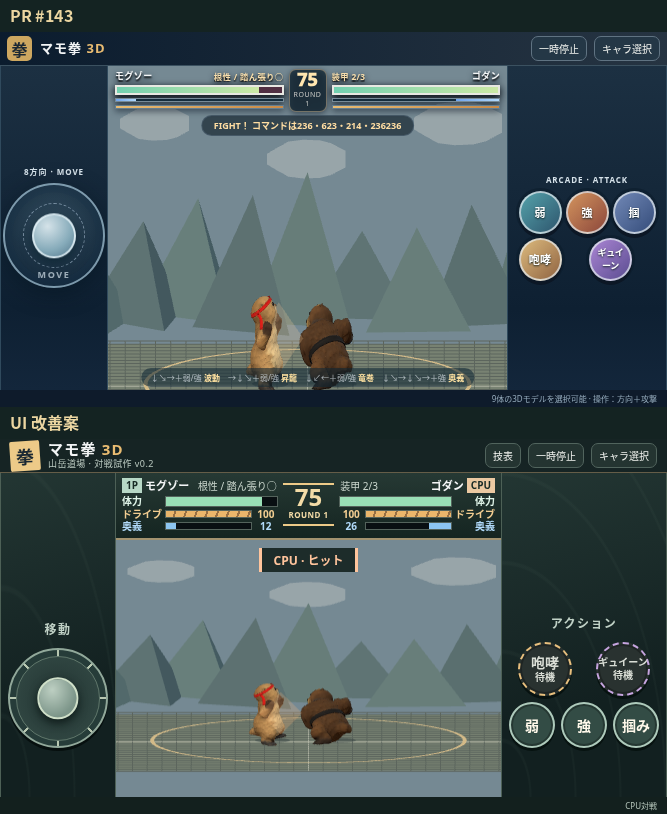
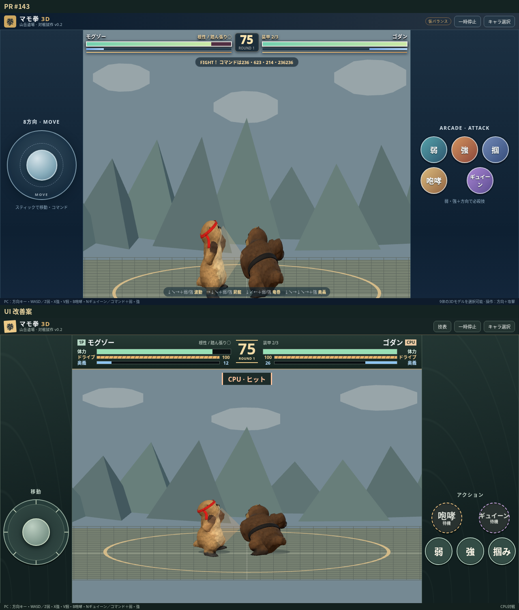
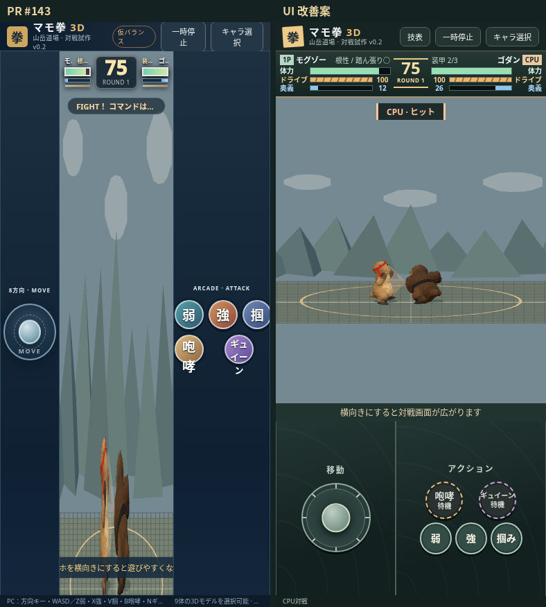
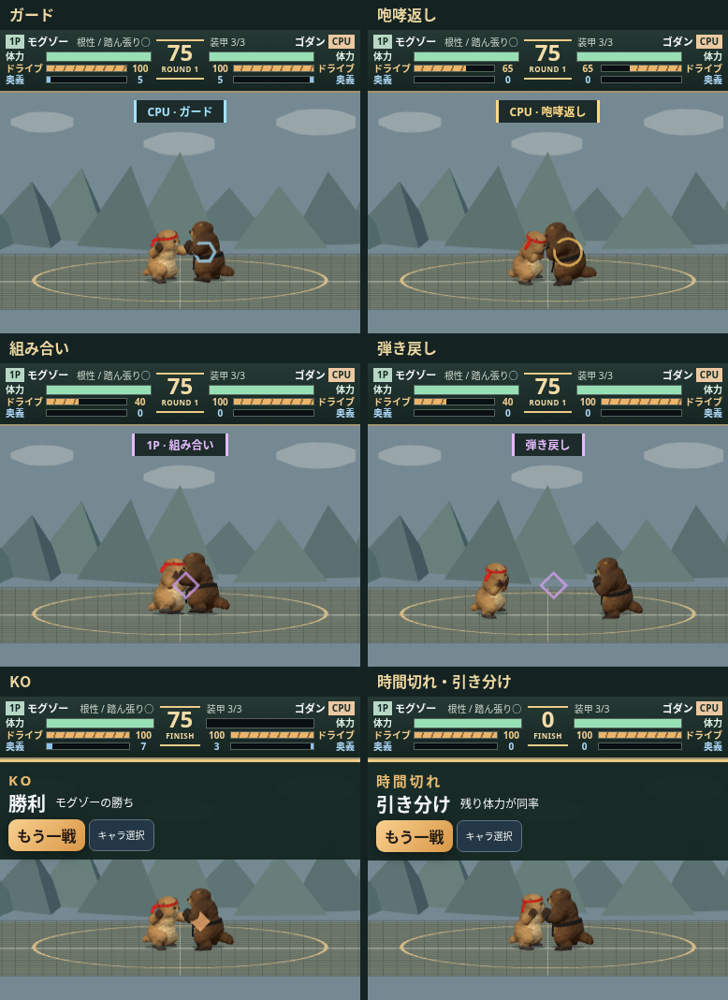

# マモ拳3D　横持ちの対戦画面レビュー

PR #143 のゲームブランチ `8e6449b` と比較した。狙いは、相手の構えを見ながら親指で移動・攻撃し、被弾した直後に咆哮で返せるかを一目で判断できること。ストリートファイター6から参考にしたのは、体力が最初に目に入り、消費資源と攻防の結果を次に読める情報の順序。山岳道場では、墨色の計器板、青磁色の体力、等高線を思わせる操作盤でまとめた。[スマホ試遊の要件 #146](https://github.com/nagi300222/mamo-ken/issues/146) ／ [レビュー項目 #149](https://github.com/nagi300222/mamo-ken/issues/149)

## 横画面で優先した変更

| 優先度 | #143で観察したこと | 改善案と実装 |
| --- | --- | --- |
| P0　親指と間合い | 左右のレール分離は機能している。667px幅では全ボタンが直径43pxで、ギュイーンの文字が途中で折れる。 | 既存レールの下寄りに、左スティックと右の二段を置く。下段は弱・強・掴み、上段はひと回り大きい咆哮・ギュイーン。左右のセーフエリアを確保し、押下の縁と沈み込みで指の反応を返す。 |
| P0　視線の行き先 | スマホでは奥義とドライブの帯が各4px。名前も残量もなく、発動できるかは押して確かめる必要がある。 | HPは太い実線、ドライブは斜線、奥義は青い細線。左右とも名前・資源名を同じ位置関係に置き、ドライブと奥義は整数値も示す。ドライブ技のボタンには「発動可」「不足」「回復中」「待機」「空中」等を表示する。入力イベントは従来どおり受け渡す。 |
| P1　足元とコマンド | 常設技表が足と床に重なる。狭い中央列でもカメラの上下幅が固定され、シルエットが縦に伸びる。 | 技表はヘッダーから開閉。向きの反転、方向の数字と矢印、攻撃ボタン、奥義の条件をまとめた。HUDと3D描画面を別の行にし、描画面の縦横比に合わせて正投影範囲を決める。 |
| P1　攻防と決着 | ヒットもガードも同じ形の発光。結果画面の「勝利／敗北」だけではKOと時間判定が読み分けづらい。 | 下記の接触演出と短い字幕を追加。結果帯には決着理由、勝敗、勝者を表示し、倒れたキャラと足元を見せたまま再戦できる。 |
| P2　実機で詰める点 | 画面上の距離だけでは、筐体の厚みや持ち方による右親指の到達差を測れない。 | ナギの普段の握りで、弱から奥側の2ボタンまで握り直さず届くか、左右を入れ替えた後の236が出せるかを試す。色とレール幅の最終決定はこの試遊後。 |

## 画面比較

同じChromium、描画倍率1、モグゾー対ゴダン、CPU「ふつう」。開始から右移動28フレーム、強入力7フレームの同じ時点を撮影した。比較画像は原寸のブラウザ画面を並べたもの。幅・直径はCSSピクセル。

| ビューポート | 中央列幅（前 → 後） | 改善後の操作寸法と観察 |
| --- | --- | --- |
| 横 844×390 | 481 → 498 | スティック127、通常約57、ドライブ技約65。中央列が広がり、HPと足元を同時に確認できる。 |
| 横 667×375 | 399 → 385 | スティック100、通常46、ドライブ技54。14pxを操作側に配分。5個すべてに独立した接触領域がある。 |
| PC 1280×720 | 807 → 862 | スティック162、通常68、ドライブ技76。キー操作の案内は下端、左右の能力・資源は上端に集約。 |
| 縦 390×844 | 164 → 390 | 上に対戦、下に左右操作。従来は左右の常設列の間で圧縮されていた対戦相手とゲージを全幅で表示。横持ちへの案内も操作を塞がない。 |

### 横 844×390

### 横 667×375

### PC 1280×720

### 縦 390×844

## 演出と決着

- **ヒット／ガード**　ヒットは短い橙の火花と攻撃側の名前、ガードは水色の六角形と防御側の名前。字幕は舞台上部に短時間だけ出る。
- **咆哮返し**　金の輪で接触位置を囲み、後出しに成功した側を字幕に出す。同時の咆哮は「咆哮相殺」として区別する。
- **ギュイーン**　紫の中空の菱形で組み合いを示し、「弾き戻し」で仕切り直しを知らせる。遠距離の空振りには接触マークを出さない。
- **KO／引き分け**　ラウンド終了時の理由と勝敗を別々に読む。時間切れなら残り体力の判定、同率なら引き分け。相打ちKOの表示は「ダブルKO／引き分け」。

下図は667×375の中央列の切り抜き。距離・入力・残りHP・時計をブラウザ検証側でそろえ、既存の戦闘処理から実際に発生したイベントを撮影した。金と紫は今回の配色案。

## 検証範囲

- Chromiumで4サイズのHUD・3D描画面・スティック・5ボタンの矩形を測定。画面外へのはみ出し、各領域の重なりは0件。
- 667×375で左スティック右下＋弱＋強の3点タッチを送信。対戦入力の4フラグと、指を離した後の押下表示解除を確認。
- 技表の開閉と4コマンド表示、ドライブ34／35／60でのボタン表示、ガード・咆哮返し・組み合い・弾き戻し、KO勝利、時間判定の敗北・引き分け、再戦、キャラ選択への復帰を確認。
- 既存の対戦テスト29件と静的配信用ビルドが成功。変更範囲は道場のHTML・CSS・表示側JSと本レビュー。実機の親指到達性、ノッチ付き端末での持ち替え、iOS SafariとAndroid実機の描画速度は未検証。
