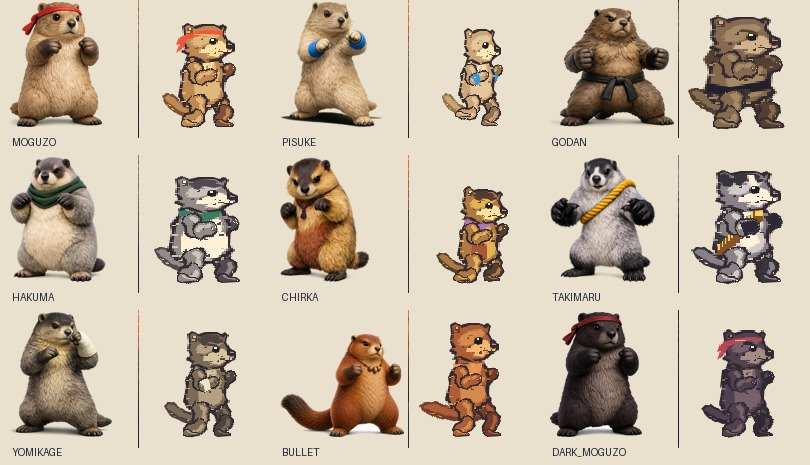

# ピクセルパーツと可動域
選択用の元絵を見て、モグゾーの丸い胴と赤鉢巻から制作した。胴、頭、尾、前後の上腕・前腕、大腿・下腿、接地する足先を別々の小さな色面として描く。乱数の種を固定した短い毛束と段差を重ね、Three.js の正投影カメラと NearestFilter で合成する。ブラウザーの Canvas2D はテクスチャ生成にのみ使用。戦闘のモデルに画像ファイルの読み込みはない。

ピスケは肩幅を狭く、腰を高くして片足を軽く上げる。ゴダンは肩を広くし、頭の位置を下げ、両脚に幅を持たせた。ゴダンの黒帯、ピスケの青い手首は対応するパーツに追従する。残り6体は胴の長さ・姿勢、顔の模様、尾と装飾を変更した。身長・寸法は全て非公式の試作値。

## 動きを追加する
1. src/data.js の技に発生・持続・硬直、接点 x/y、半径、脚を使うかを定義する。y は身長比、x は横方向の論理ピクセルで、左右反転はエンジンが扱う。
2. 通常の突き／蹴りは rig().pose の溜め・伸展・戻りをそのまま使える。個別演技は肘・膝の曲げ、腰の傾き、後ろ腕の支えを追加する。片方の足先だけを伸ばす場合は kick を設定する。
3. 追加実験では共通の突きから、上昇中に逆腕を引く対空、両手を重ねる投げ、着地時に足裏を水平に戻す動きを追加した。差分は関節とパーツ定義のみ。攻撃判定と伸展先は同じ技データを読む。
4. 近距離／先端／空振りをテストしてから対戦キャプチャを比較する。対戦での髪・毛先の二次動作や指の握り分けは簡略化している。原画に対する似姿の採否は作者レビュー対象。

