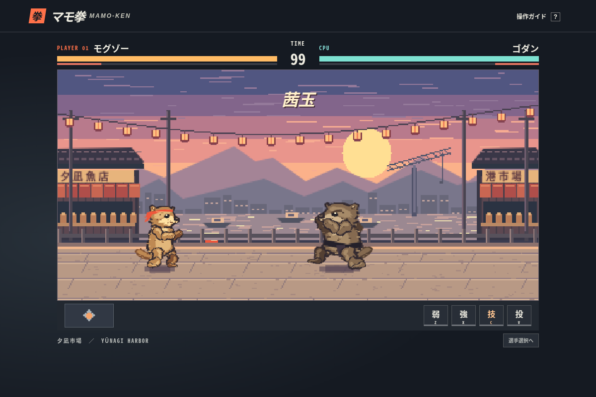

# マモ拳　夕凪市場
9人の選手から1人を選び、夕暮れの港でCPUと99秒一本勝負。各選手に6通常技、3必殺、奥義、投げがあります。操作ガイドは試合中にも開けます。開いている間、試合時計は止まります。



## Windows / PowerShell で起動
Node.js 24 LTS をインストールし、リポジトリのルート（旧版の package.json がある mamo-ken フォルダー）から実行します。

```powershell
cd .\prototype\threejs-reimagined
npm.cmd ci
npm.cmd run dev
```

ターミナルに出る Local アドレスを WebGL 2 対応の Edge、Chrome 等で開きます。選手の原画をクリックし、CPUを選んで「対戦開始」。終了はターミナルで Ctrl+C。PowerShell のスクリプト実行ポリシーの影響を避けるため例では npm.cmd を使用しています。通常の npm ci、npm run dev、npm test も同じ処理です。

同じWi-Fiのスマホから試す場合は信頼できるローカルネットワークで `npm.cmd run dev -- --host 0.0.0.0` を実行し、表示される Network アドレスを横画面で開きます。

## 操作
| 操作 | キーボード | 横持ちタッチ |
|---|---|---|
| 移動・しゃがみ・ジャンプ | 矢印または WASD。斜め入力で前後ジャンプ | 左パッドをスライド |
| ガード・ダッシュ | 相手の反対方向でガード。左右を同じ方向に2回でダッシュ | 同じ方向規則 |
| 弱・強 | Z・X。立ち、しゃがみ、空中で変化 | 弱・強 |
| 弾または突進 | C または 236＋弱／強 | 技 |
| 対空必殺 | 下＋C または 623＋弱／強 | 下＋技 |
| 変化技 | 後ろ＋C または 214＋弱／強 | 後ろ＋技 |
| 投げ・ギュイーン | V、または前＋Vで踏み込みクリンチ | 投、前＋投 |
| 奥義 | ゲージ60以上で B または X＋C | 強＋技 |

数字は右向き時のテンキー方向。2＝下、3＝右下、6＝右、4＝左。左向き時は左右が反転。ヨミカゲの月輪は後ろを28フレーム以上溜めて前＋弱／強／技。しゃがみ攻撃はしゃがみガード、空中攻撃と崩しには立ちガード。投げはガードを崩し、ジャンプで避けられます。弱技の命中直後に必殺を重ねると連係できます。体力下の細いゲージが明るく光れば奥義を使用できます。

## 検証
```powershell
npm.cmd test
npm.cmd run build
```
自動テストは描画から独立し、各選手の技・ガード・能力と81対戦を実行します。ブラウザー操作の再検証は任意です。開発サーバーを起動した状態で Python の Playwright・Pillow と Chromium を用意し、`python tools/browser_check.py` を実行します。独自のブラウザーパスは CHROMIUM_PATH で指定できます。通常の起動と npm test に Python は不要です。

[PC選択画面](evidence/pc-select.png) · [横画面の対戦](evidence/mobile-moguzo.png) · [原画と全9体の比較](evidence/roster-comparison.jpg) · [モーションGIF](evidence/moguzo-motion.gif) · [対戦検証結果](MATCHUPS.md)

[技と能力の設計](DESIGN_DECISIONS.md) · [リグとモーションの追加方法](ART_APPROACH.md) · [旧版との差分](DIFF_FROM_LEGACY.md)
